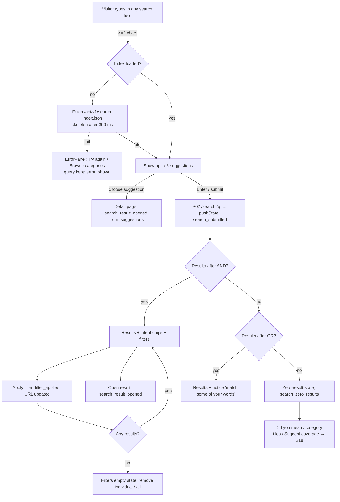
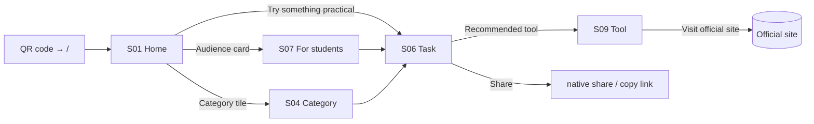
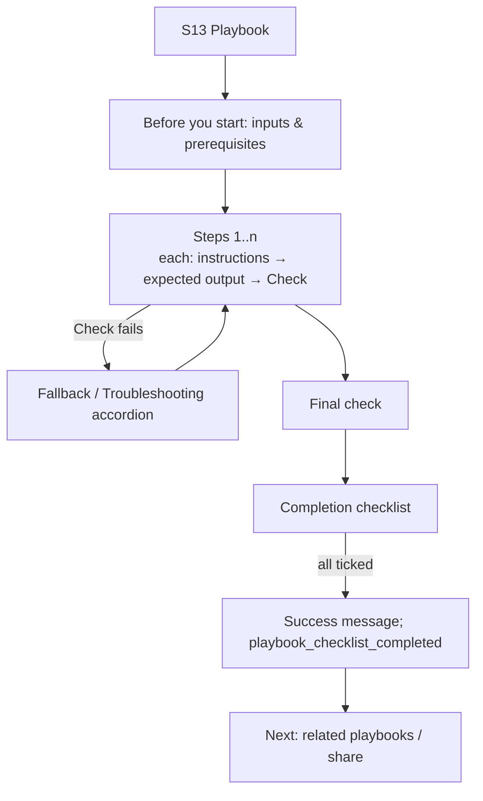
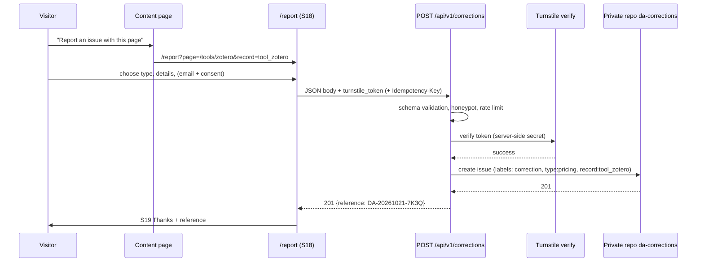
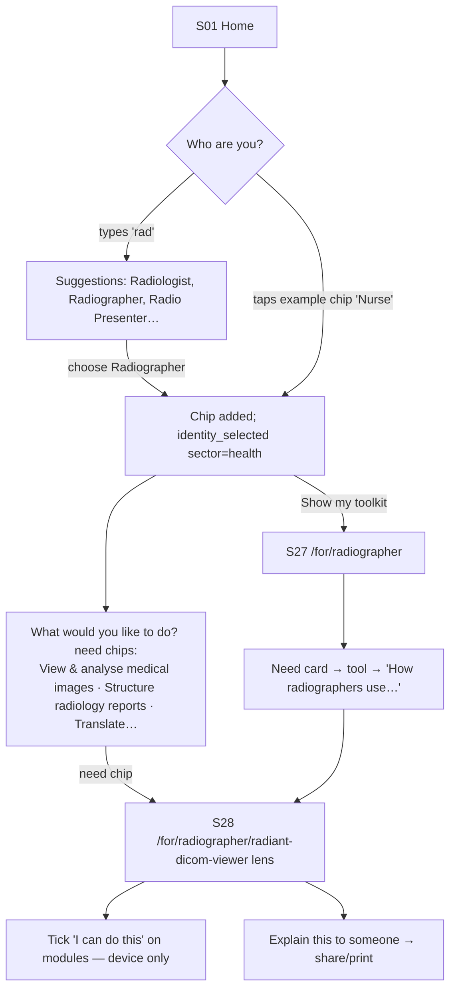
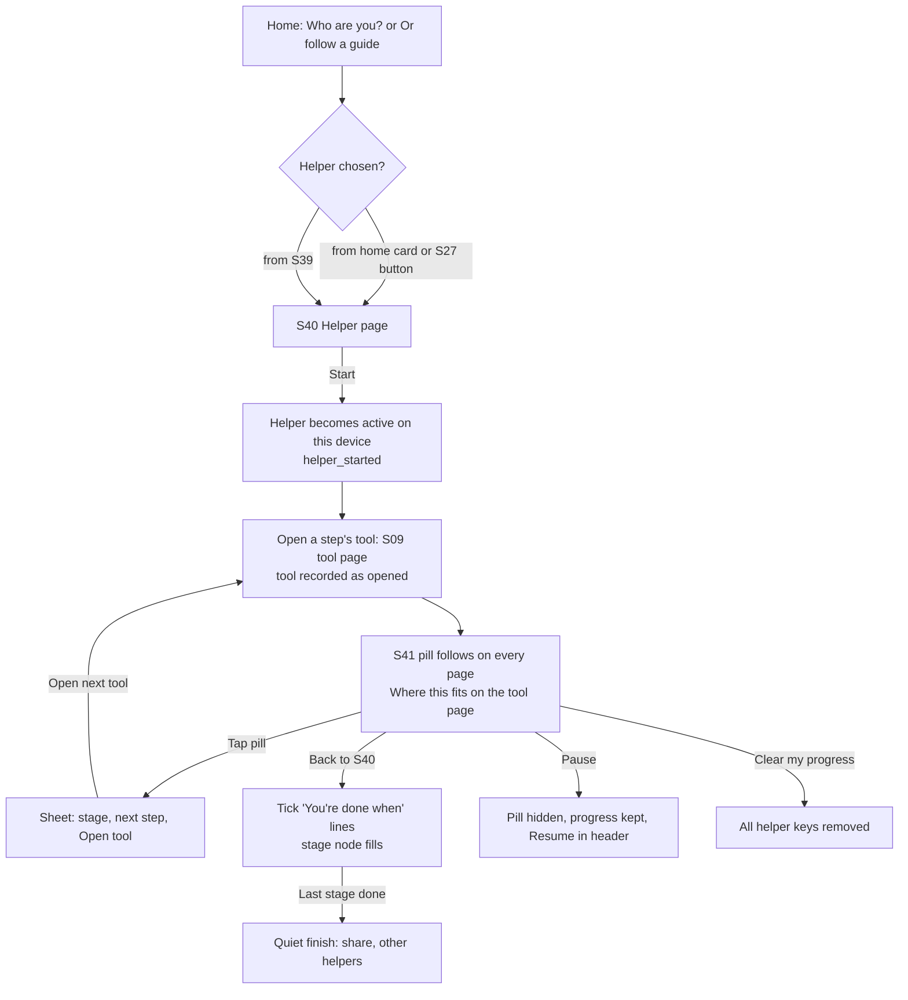

# 05 — User Journeys and Interaction Flows

**Version:** 2.5 · Diagrams are Mermaid and render in GitHub. Screen IDs refer to `04`.

## 1. Search flow (Journeys B, C, D)

**Back/Forward:** the result set, filters, tab and page are restored from the URL, and scroll position is restored by the browser. Typing uses `replaceState`; submit and filter changes use `pushState`.

## 2. Browse flow (no search) — Journey A (classroom QR)

**Rule:** no screen in this flow requires search, an account or JavaScript (except Share).

## 3. Tool discovery and decision — Journey C (free-tool seeker)
1. The visitor searches "free video editor". Cost intent is detected, so tools that can be started without paying are boosted and a chip offers "Only show options you can start without paying".
2. The visitor taps the chip. `cost=can-start-free` is applied, and paid-only tools disappear while the filter is on.
3. The visitor opens Shotcut (S09) and sees the "Open source" badge, "checked 21 Oct 2026", the platforms and the limitation "Desktop only".
4. They follow "Compare free video editors" to S14 and read the best-fit statements.
5. They click "Visit official site" (`official_link_clicked`).

**Acceptance:** at no point is a freemium or trial product labelled "Free" (V1 test 1).

## 4. Resource use
S06/S09 → ResourceCard (type, cost, sign-up shown before leaving) → S11 (optional) → "Open on {publisher}" → external.
- If the link is broken: S11 shows "This link may no longer work" and the replacement resource.
- The visitor can report the problem via "Report an issue", with `type=broken_link` prefilled.

## 5. Playbook completion — Journey D

The checklist state lives in memory only and resets on reload. This is stated in small text under the checklist: "Ticks aren't saved."

## 6. Correction reporting

Failures follow the S18 error table. The issue body never includes the visitor's IP address.

## 7. Editorial operations — Journey F
```mermaid
flowchart TD
  D1[Discover candidate<br/>(research queue, zero-result queries, corrections)] --> D2[Check duplicates:<br/>search repo + validator name check]
  D2 --> D3[Research official sources<br/>record sources[] with quotes]
  D3 --> D4[Create JSON from template<br/>status: draft]
  D4 --> D5[Open PR, set status: in_review<br/>label: content]
  D5 --> CI{CI: schema + integrity + links + search test set + build}
  CI -- fail --> D4
  CI -- pass --> PV[Cloudflare preview deployment<br/>in_review visible with banner]
  PV --> R{Reviewer (≠ author when possible)<br/>uses Review checklist 07 §7}
  R -- changes --> D4
  R -- approve --> PUB[Author sets status: published, reviewer, published_at<br/>merge → production deploy]
  PUB --> SCH[next_review_at scheduled]
  SCH --> MON[Weekly jobs: link check + freshness report]
  MON -->|overdue / broken / correction| NR[status: needs_review]
  NR --> D3
  NR -->|discontinued| AR[availability: discontinued<br/>status: archived + alternatives]
```

## 8. Theme switching
1. On first load, an inline head script reads `localStorage['da-theme']` (in try/catch) and sets `data-theme` before first paint.
2. The toggle cycles through System → Light → Dark. It is a menu button with three radio options and announces "Theme: Dark".
3. If storage fails, the toggle still works for the current page.

## 9. V2.1 — Journey G: "Who are you?" (identity-first)


## 10. Journey H: helping someone else
1. Turn on "I'm helping someone else".
2. "Who are you helping?" → "Farmer".
3. The toolkit page reads "Digital toolkit for Farmers" with the helper banner "Sharing with a farmer? Use the toolkit card below."
4. Choose Print or "WhatsApp text". The card lists 6 needs with one starter tool each and the first module to learn.
5. `toolkit_shared` fires (method only).

## 11. Journey I: tool-first cross-domain discovery ("clarity tool")
1. The visitor searches "canva" and opens S09.
2. **Who uses Canva** shows 19 sectors.
3. **Surprising uses** shows Pastors → worship media, Nurses → patient leaflets, Farmers → harvest price lists.
4. The visitor opens "Canva for farmers and agribusinesses" (S29).
5. They pick their own identity in the lens switcher and the path re-orders for them (S28).

## 12. Journey J: one person, several identities
A nurse who is also a content creator picks both. The toolkit shows tabs for **Nurse** and **Content creator** plus **Shared by both** (for example *Create clear patient information* ↔ *Short video*). Lenses from both identities appear in "Start learning".

## 13. V2.5 — Journey K: following a helper

**Rules:** progress never leaves the device (FR-069); no streaks, points or badges; the helper never blocks navigation (the person can ignore the pill).

## 14. Journey L: starting a helper for someone else
`S40 [Start for someone else]` → optional label ("for Mum", device only) → the helper runs as in Journey K → [Share] sends a link to the helper page (no label) or the WhatsApp text (≤ 1,000 characters) → the friend opens the link and starts their own helper. The same screens serve both journeys; only the pill's wording changes ("for {label}").
