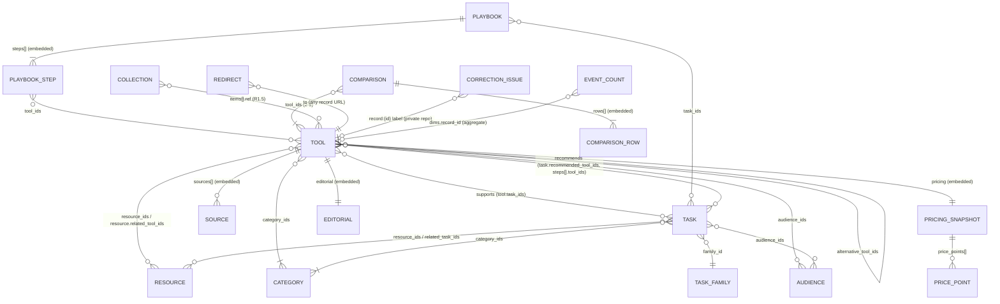
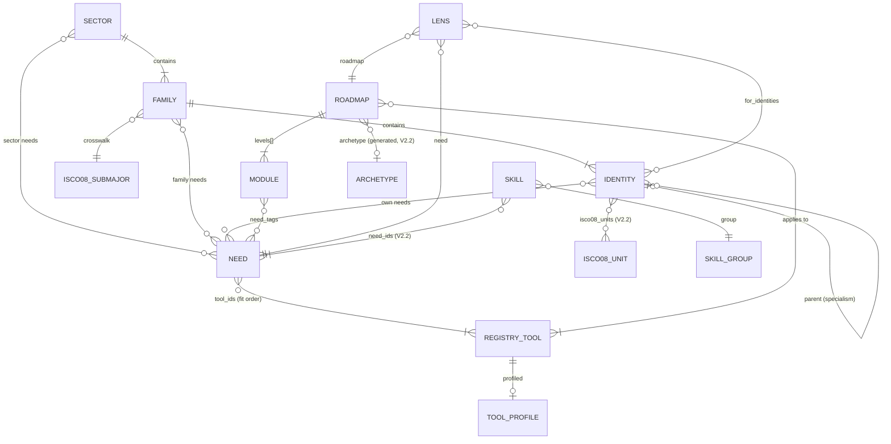

# 09 — Data Schema and ERD

**Version:** 2.5 · **Storage decision:** content lives as versioned JSON files in Git (D-011); aggregate analytics lives in Cloudflare D1 (D-016); correction reports live as issues in a private GitHub repo (D-015). The field-level contract is the JSON Schemas in `spec-assets/schemas/`.

## 1. Entity-relationship diagram

Every content type (tool, task, resource, playbook, comparison) embeds `SOURCE[]`, `EDITORIAL` and `DISCLOSURE`. The diagram shows this for TOOL only, to keep it readable.

## 2. Entities
| Entity | Storage | Key | Uniqueness | Relationships | Delete behaviour | Archive behaviour | Public fields |
|---|---|---|---|---|---|---|---|
| Tool | `content/tools/{slug}.json` | `id` | id global; slug per type | → task, tool, resource, comparison, playbook, category, audience | **Never hard-delete a published record.** Archive instead. Hard delete is allowed only for draft/in_review. | Stays at its URL with a notice; excluded from related/curation; ranked last; removed from sitemap | All except `x-visibility: private` |
| Task | `content/tasks/{slug}.json` | `id` | same | → tool, resource, playbook, task, category, audience, task_family | same | same | same |
| Resource | `content/resources/{slug}.json` | `id` | same | → tool, task, replacement resource | same | same | same |
| Playbook (+ steps) | `content/playbooks/{slug}.json` | `id`; step key `n` | step `n` 1..k contiguous | → tool, task, resource, playbook, category, audience | same | same | same |
| Comparison (+ rows) | `content/comparisons/{slug}.json` | `id` | one cell per tool per row | → tool (2–3), task, category | same | Archive if any compared tool is archived and no replacement is set | same |
| Collection | `content/collections/{slug}.json` (R1.5) | `id` | — | → any record | same | same | same |
| Category / Task family / Audience / Vocabularies | `spec-assets/taxonomy/*.json` (copied to `content/taxonomy/`) | `id`/`slug` | slug unique | ← records | Never delete; `retired: true` + `replaced_by` | Retired values hidden from editors and visitors | Labels, descriptions |
| Source | Embedded in each record `sources[]` | `id` (unique within record) | unique within record | ← claims via `source_ids` | Remove only when no claim cites it (validator warns about unused sources) | — | title, publisher, url, checked_at (not quote, notes) |
| Pricing snapshot | Embedded `tool.pricing` | — | one per tool | → sources | Replaced on update; **history is the Git log** | — | All |
| Editorial | Embedded `editorial` | — | one per record | — | — | — | status (implicitly), last_verified_at, public_corrections |
| Redirect | `content/redirects.json` + `redirect_from[]` on records | `from` | `from` unique | → any URL | Keep indefinitely | — | Generated `_redirects` |
| Correction issue | Private GitHub repo issue | issue number; public reference `DA-YYYYMMDD-XXXX` | reference unique | label `record:{id}` | Closed, never deleted; email redacted at close or 90 days | — | **None** |
| Event count | D1 `event_counts` | (day, event, dims) | composite PK | dims may include record_id | Retention jobs (90 days / 25 months) | — | **None** (internal dashboards only) |
| Audit record | Git commits + PR reviews | commit SHA | — | — | Never rewrite `main` history (branch protection) | — | Public repo history |
| User, bookmark, progress | **Not in R1.** R1.5 bookmarks are browser-only (`localStorage['da-bookmarks']`: array of ids, max 200). R2 accounts get a separate schema and privacy review. | — | — | — | — | — | — |

## 3. Build-time indexes (in-memory during the build)
The build (the React Router prerender step) loads all JSON once and creates:
- `byId: Map<id, record>` and `bySlug[type]: Map<slug, record>`;
- reverse indexes:
  - `toolsByTask` — from task.recommended_tool_ids ∪ tool.task_ids;
  - `tasksByTool`;
  - `recordsByCategory`;
  - `recordsByAudience`;
  - `playbooksByTool`;
  - `comparisonsByTool`;
  - `resourcesByTool`;
- `recentlyReviewed`: published, sorted by last_verified_at desc.

The related-content rules in `03` §5.2 use only these indexes, so results are deterministic and reproducible.

## 4. Validation and integrity rules
Every rule in Gap Analysis §20.3 is implemented in `07` §9 and the reference validator:
- unique slugs;
- published records pass publication validation (CI);
- no dangling references;
- no redirect loops;
- archived records are excluded from recommendations (build rule + test TC-024);
- no user-owned records in R1;
- editorial changes are auditable (Git + PR review required by branch protection);
- migrations are versioned (§5).

Valid and invalid examples are in `spec-assets/fixtures/`. `fixtures/invalid/EXPECTED.json` lists each invalid case and the error it must produce. The valid fixtures are schema-valid and deliberately reference a non-existent task, so they are used for schema tests only, not integrity tests.

## 5. Migrations
- **Content schema:** every record carries `schema_version`. A breaking change means:
  1. bump the schema `$id` and `schema_version` (e.g. 2.1);
  2. add `scripts/migrations/content-{NNN}-{name}.ts`, which transforms the files in place idempotently;
  3. run it in the same PR as the schema change;
  4. CI validates every record against the new schema.

  Non-breaking additions (new optional field) need no migration.
- **D1:** numbered SQL files in `migrations/` (first: `spec-assets/db/0001_analytics_counters.sql`), applied with `wrangler d1 migrations apply`. They are tested against a local D1 in CI before deploy.

## 6. If the content moves to a relational database later
Map each content type to a table with the same column names. Embedded arrays become tables:
- `tool_sources`;
- `claims (record_id, field, idx, text, kind)`;
- `claim_sources`;
- `price_points`;
- `playbook_steps (playbook_id, n, …)`;
- `comparison_cells (comparison_id, dimension, tool_id, text, kind)`.

Many-to-many arrays become join tables (`tool_tasks`, `tool_categories`, …), with FKs `ON DELETE RESTRICT` (archive instead of delete). Taxonomy enums become lookup tables with FK constraints. Indexes: `(type, slug)` unique; `editorial_status`; `next_review_at`; `last_verified_at` desc. The export file (`/export/catalogue-v2.json`) is the migration source.

## 7. Data retention summary
| Data | Retention | Deletion method |
|---|---|---|
| Content records and history | Indefinite (public, CC BY) | Archive; never rewrite history |
| Correction issue text | Indefinite (private) | — |
| Reporter email in correction issues | Until close or 90 days, whichever is first | Automated redaction job (16 §6) |
| Event counters | 25 months | Scheduled delete |
| Zero-result query strings | 90 days | Scheduled delete |
| Rate-limit counters | ≤ 10 minutes (in memory or KV with TTL) | TTL |
| Cloudflare logs | Provider default; not exported | — |

## 8. V2.1 identity layer — ERD

| Entity | Storage | Key | Integrity rules (validator) | Delete / retire |
|---|---|---|---|---|
| Sector | `taxonomy/identities/sectors.json` | slug | needs exist | Retire only |
| Family | `…/families.json` | slug | sector exists; ISCO code in list; needs exist | Retire only |
| Identity | `…/identities.json` | slug (unique) | family belongs to sector; parent exists; needs exist | `retired: true` + `replaced_by`; route 301 |
| Need | `taxonomy/needs.json` | slug | task family exists; every tool in registry | Retire only; lenses must be migrated first |
| Registry tool | `registry/tools-registry.json` | slug | category exists; `profiled` ⇔ full record exists; pricing always unknown | Retire with redirect to successor |
| Roadmap / module | `records/roadmaps/*.json` | roadmap slug; module slug (globally unique) | tools exist; need tags exist; `authoring` ∈ handwritten / archetype / archetype+signature; ≥ 90% of registry tools covered (V2.2) | Modules never renumbered; retire with `retired: true` (future field) |
| Lens | `records/lenses/{roadmap}--{need}.json` | (roadmap, need) | roadmap, need, identities, pair tools exist; priority modules belong to the roadmap | Archive as V2 records |
| Skill (V2.2) | `taxonomy/skills.json` | slug | group exists; needs exist; tools exist; every need belongs to ≥ 1 skill | Retire only; redirect to nearest skill |
| ISCO-08 unit group (V2.2) | `…/isco08-unit-groups.json` | 4-digit code | all 436 covered by ≥ 1 identity | Never deleted |
| Derived | `generated/lens-index.json`, `generated/who-uses-each-tool.json`, `generated/roadmap-coverage.json`, `generated/resolved-needs.json`, `occupations/*` | — | Regenerated each build by `spec-assets/generators/`; never hand-edited | — |

**Device-only data (R1):**
- `localStorage['da-identities']`: array of ≤ 3 slugs.
- `localStorage['da-progress']`: map of module slug → ISO date ticked.

Both are wrapped in try/catch and never transmitted. **R2** moves progress to accounts under a new privacy review.

## V2.5 additions — Helper data and device storage
### Helper (generated, read-only in the app)
| Field | Type | Rules |
|---|---|---|
| `slug` | string | unique, kebab-case, ≤ 40 characters |
| `title`, `promise`, `intro` | string | see `helper.schema.json` for lengths |
| `identities` | string[] | 1–12 identity slugs; the first is the headline identity |
| `stages[]` | array | 3–8 stages: `n`, `title`, `goal`, `time`, `steps[]` (`tool`, `need`, `what`, `first_win`), `done[]` |
| derived | numbers | `stage_count`, `tool_count`, `profiled_tools[]` (tools with a full pilot profile) |
Source: `taxonomy/source/helpers.txt`, built by `generators/build_helpers.py`; validated against `schemas/helper.schema.json`. Pilot tool guides: `taxonomy/source/pilot_profiles.txt` → `taxonomy/pilot-profiles.json` (`review_status: pending` until a human checks them).

### Device storage (never sent to a server)
| Key | Contents | Notes |
|---|---|---|
| `da.helper.v1` | `{active, paused, label, progress: {<helper>: {ticks: {"<stage>.<line>": true}, opened: [<tool>]}}, updated}` | No identity slug. Unknown versions are ignored. |
| `da.ticks.v1` | Roadmap module ticks | D-051 |
| identity choice | See 18 §10 | D-053 |
All reads and writes are wrapped in try/catch; the app works without storage. "Clear my progress" removes `da.helper.v1` and `da.ticks.v1`.
