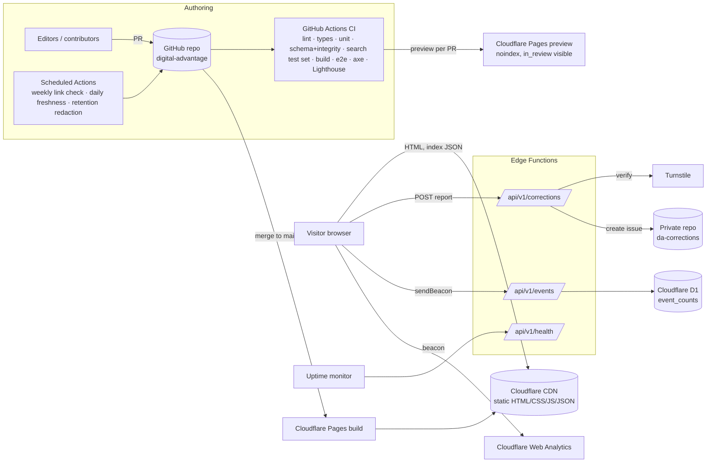

# 11 — Technical Architecture and ADRs

**Version:** 2.5 · Implements V1 07's logical layers with concrete choices (decision register D-010 to D-017, D-039 to D-041, and D-069 for the Bun + Vite + React base). **ADR-008 supersedes ADR-001.**

## 1. Architecture overview


## 2. Layers (V1 07 §2 mapping)
| V1 logical layer | R1 implementation |
|---|---|
| Presentation | React components, routed and prerendered by React Router (framework mode) on Vite; interactive parts (search, filter drawer, menu, theme, share, report form, playbook mini-map, **helper panel**) are React components with code splitting (ADR-008) |
| Content | JSON records in `content/`, validated by JSON Schema; a build-time loader (`src/lib/content.ts`) feeds the route loaders |
| Search | MiniSearch index built at build time; client-side query, facets, ranking adjustments |
| Editorial/admin | GitHub PRs + CODEOWNERS + CI + preview deploys; automated report issues |
| Monitoring | Uptime monitor (D-018), CF Web Analytics, error events, scheduled link and freshness jobs |
| Optional account layer | Not built (R2) |
| Optional AI layer | Not built (R2) |

## 3. Repository layout
```
digital-advantage/
├─ content/                    # JSON records (from 08_Starter_Catalogue/records), pages/*.md, curation/*.json, taxonomy/*.json, helpers.json, redirects.json
├─ schemas/                    # copy of spec-assets/schemas (canonical; CI checks parity with Zod)
├─ app/                        # React Router app (framework mode)
│  ├─ root.tsx                 # shell: header, bottom tab bar, helper panel mount, theme script
│  ├─ routes.ts                # route table = 03 §1, §7, §8
│  ├─ routes/                  # one file per screen: home.tsx, for.$identity.tsx, tools.$tool.tsx, helpers.tsx, helpers.$slug.tsx, skills.tsx, …
│  ├─ components/              # per 06 §6 and §12 (Header.tsx, SearchField.tsx, ContentCard.tsx, HelperCard.tsx, RouteRail.tsx, HelperPill.tsx, …)
│  ├─ hooks/                   # useSearch, useTicks, useHelper (device storage), useTheme, useShare
│  └─ styles/                  # tokens.css (generated from tokens.json: bun run tokens), base.css, components/*.css
├─ src/lib/                    # pure TypeScript, framework-free: content loader, indexes (09 §3), identity engine (port of reference_engine.py), related.ts, search-build.ts, search-runtime.ts, pricing.ts, helpers.ts, format.ts
├─ react-router.config.ts      # ssr: false; prerender paths from the content loader (ADR-008)
├─ vite.config.ts · bunfig.toml · bun.lock · tsconfig.json
├─ functions/api/v1/           # corrections.ts, events.ts, health.ts (Cloudflare Pages Functions, unchanged)
├─ migrations/                 # D1 SQL
├─ scripts/                    # validate-content.ts (port of validate_catalogue.py), build-tokens.ts, check-links.ts wrapper, freshness-report.ts, redact-corrections.ts, csp-hashes.ts, migrations/content-*.ts
├─ tests/ unit/ components/ e2e/ a11y/ fixtures/ search/
├─ public/                     # _headers, robots.txt, fonts/, og/, icons
└─ .github/                    # workflows/, CODEOWNERS, PULL_REQUEST_TEMPLATE.md (review checklist 07 §7), ISSUE_TEMPLATE/
```

## 4. Data flows
1. **Publish:**
   - PR → CI validation → preview → approval → merge.
   - The build reads `content/` and creates:
     - static pages;
     - per-record JSON;
     - search index;
     - sitemap;
     - RSS;
     - export;
     - `_redirects`.
   - Deploy is atomic, so previous deployments stay available for rollback.
2. **Search:** first focus → fetch index (gzip) → MiniSearch `loadJSON` → query on input (debounce 120 ms) → apply facets and ranking adjustments → render.
3. **Correction:** form → Function → Turnstile → GitHub API → reference → S19.
4. **Analytics:** beacon → Function → D1 upsert. Dashboards are a scheduled Action that queries D1 via the API with a read token and posts the weekly report to a private issue.
5. **Freshness:** a daily Action runs `freshness-report.ts`, which lists overdue records, records due within 14 days, missing evidence and status counts, and updates a pinned issue in the public repo (no private data). The same Action opens a PR setting `needs_review` for anything more than 30 days overdue.
6. **Link checking:** a weekly Action runs lychee over all `official_url`, `canonical_url` and `sources[].url` values. Settings:
   - concurrency 4;
   - per-host delay 1 s;
   - User-Agent `DigitalAdvantageLinkCheck/1.0 (+SITE_URL/about)`;
   - accepts 200–399 and 403/429 as "blocked/unknown" (not broken).

   Results update `link_check` on resources via a bot PR. Two consecutive confirmed failures (404/410/DNS) set the record to `needs_review`.

## 5. Failure modes
| Failure | Effect | Mitigation | Test |
|---|---|---|---|
| Search index fetch fails | No search results | ErrorPanel with retry + browse link; all pages still navigable | TC-031 |
| JS disabled or fails | No search UI, menu falls back | Menu is a `<details>` fallback; search form posts to `/search` with a `<noscript>` message and category links; all content is static | TC-047 |
| Turnstile unavailable | Can't submit report | Show the email fallback | TC-035 |
| GitHub API down | Report not stored | 502 + retry + email fallback; form data kept | TC-034 |
| D1 down | Events lost | 204 to client; logged | TC-051 |
| CF Web Analytics blocked | No page views | None needed | — |
| External official site down | Outbound link fails | The page states the link goes to a third party; link check flags it | TC-046 |
| Bad content merged | Wrong info live | Atomic rollback in CF Pages (≤ 5 min) + `git revert` | TC-055 |
| Build fails | No deploy; previous version stays live | CI blocks merge on build failure | — |
| Font CDN | n/a (self-hosted) | — | — |

## 6. Architecture decision records
Each ADR covers context, decision, consequences, limitations, cost, portability and replacement.

**ADR-001 Static site generation with Astro (D-010) — superseded by ADR-008, kept as the fallback**
- **Context:** a content-heavy public site where mobile performance is the priority; small team; SEO matters.
- **Decision:** Astro SSG, TypeScript strict, minimal islands in vanilla TS.
- **Consequences:**
  - (+) near-zero JS on content pages;
  - (+) cheap hosting;
  - (−) content changes need a rebuild (seconds to minutes), which is acceptable.
- **Limitations:** dynamic features need Functions.
- **Cost:** £0 framework.
- **Portability:** high. Content is plain JSON, and components are simple HTML/CSS.
- **Replacement:** Eleventy, or Next.js (static export).

**ADR-002 Git-based JSON content with JSON Schema (D-011, D-012)**
- **Context:** need validation, review, audit history, exportability and no CMS cost.
- **Decision:** files in Git; JSON Schema is canonical; PR workflow.
- **Consequences:**
  - (+) full history and review for free;
  - (+) CI-enforced quality;
  - (−) non-technical editors need GitHub's web editor or a later Git-CMS UI.
- **Limitations:** concurrent edits to one file can conflict; that is rare at this scale.
- **Portability:** export to any CMS or DB (09 §6).

**ADR-003 Client-side search with MiniSearch (D-013)**
- **Context:** search must work without AI; no server budget; must be testable offline.
- **Decision:** a prebuilt MiniSearch index with field boosts, fuzzy and prefix matching, synonyms and deterministic ranking adjustments.
- **Consequences:**
  - (+) no server;
  - (+) the CI test set runs in Node;
  - (−) index size grows with the catalogue.
- **Limitations:** re-evaluate at 400 KB gzip or 5,000 records.
- **Replacement:** Pagefind (static, chunked), or hosted Meilisearch/Typesense.

**ADR-004 Cloudflare Pages + Functions + D1 + Turnstile + Web Analytics (D-014–D-017)**
- **Context:** one provider for static hosting, three tiny endpoints, a bot check, cookieless analytics and a small SQL store.
- **Consequences:**
  - (+) one dashboard and low cost;
  - (−) vendor concentration, mitigated because every piece is standard (static files, fetch handlers, SQLite SQL).
- **Limitations:** free-tier quotas must be confirmed at setup and recorded in 16 §2.
- **Replacement:** Netlify (Functions, Forms), or Vercel + Postgres/SQLite.

**ADR-005 Corrections as private GitHub issues (D-015)**
- **Context:** we need a private triage queue with labels, assignment and history, without building an admin UI.
- **Consequences:**
  - (+) zero UI to build;
  - (+) familiar workflow;
  - (−) the GitHub token is a sensitive secret, so scope it to Issues on that repo only and rotate it every 90 days.
- **Replacement:** a D1 table + a simple authenticated admin page (R2), or any helpdesk.

**ADR-006 No accounts in R1 (D-004)**
- **Context:** V1 07 §12 says to avoid premature complexity; accounts carry privacy obligations.
- **Consequences:** bookmarks are deferred (R1.5 device-only); progress is deferred (R2).

**ADR-007 CSS-only motion (06 §7)** *(the "no UI framework" half is superseded by ADR-008)*
- **Context:** performance budgets and reduced-motion support.
- **Consequences:** motion is done in CSS, not a JavaScript animation library, so it is cheap and easy to disable.

**ADR-008 Bun, Vite and React with React Router framework mode (D-069; supersedes ADR-001)**
- **Context:** the owner wants Bun, Vite and React as the base of their stack. The product now has app-like parts (the identity picker, search, the helper panel with device-stored progress) next to thousands of content pages that must be fast on 3G and readable by search engines at launch.
- **Decision:**
  - **Bun** for install, scripts and local runtime (version pinned with `BUN_VERSION` and `bun.lock`).
  - **Vite** as the bundler; **React** (current stable, pinned) with **TypeScript strict**.
  - **React Router in framework mode** with `ssr: false` and a `prerender` list built from the content loader, so every content route is written as static HTML plus a data file. The output (`build/client`) is deployed to Cloudflare Pages. Functions are unchanged.
  - Framework-free logic stays in `src/lib` (identity engine, indexes, search), so it moves with the content if the rendering layer ever changes.
- **Facts checked on 21 October 2026:**
  - The Cloudflare Pages build image supports Bun (default 1.2.15 at the time), and the version can be set with the `BUN_VERSION` environment variable.
  - React Router's `prerender` option takes `true` (static paths only) or an array or async function of concrete paths; dynamic routes need the explicit list. Each prerendered path produces an `.html` file and a `.data` file. Paths are prerendered one at a time by default; parallelism is an opt-in marked unstable.
  - With `ssr: false` and a partial list, a single-page fallback file is written and the host must serve it for unmatched paths.
- **Consequences:**
  - (+) the owner's stack, one language end to end, rich interactions are straightforward;
  - (+) content stays static and CDN-cached, so cost and failure modes are unchanged;
  - (−) **more JavaScript per page than Astro**: the budgets in 14 §3 are reset and enforced in CI;
  - (−) prerendered pages carry inline scripts, so the CSP needs a plan (hash each page's inline scripts at build with `scripts/csp-hashes.ts` and emit them in a per-page `<meta http-equiv="Content-Security-Policy">` or `_headers`, whichever the host's rule limits allow; "unsafe-inline" is not acceptable);
  - (−) ~3,700 routes × two files may be slow to prerender and large for the host's file limits.
- **Beta shortcut:** prerender the core routes (home, helpers, tools, needs, skills, the most-viewed identities) and let the single-page fallback serve the rest. The beta is `noindex`, so search engines don't matter yet. **Full prerender is a public-launch gate** (FR-074).
- **Spike S-1 (first day, before Milestone B).** Build a throwaway slice and record in `docs/limits.md`:
  1. full-prerender build time and file count against the host's current limits;
  2. initial JavaScript (gzip) on the home page, a tool page and a helper page;
  3. the CSP approach working on a deployed preview;
  4. `bun install --frozen-lockfile && bun run build` succeeding on Cloudflare Pages with `BUN_VERSION` set.
  **Decision rule:** if (1) exceeds the host's limits, or (2) misses the 14 §3 budgets by more than 30% after code splitting, switch the rendering layer to **Astro with React islands** (ADR-001 as the fallback). Content, schemas, `src/lib`, tests and the Functions carry over unchanged.
- **Alternatives considered:**
  - *Plain Vite SPA:* fastest to build, but no static HTML, so a slow first paint on 3G and poor discovery. Acceptable for the private beta only.
  - *Next.js static export:* works, but adds a second framework's conventions the owner didn't ask for.
  - *Astro + React islands:* the lightest pages, but not the owner's preferred base. Kept as the fallback.
- **Cost:** £0 framework. **Portability:** high (JSON content, plain TypeScript logic, standard static output). **Replacement:** Astro with islands, or Next.js static export.

## 7. Technology versions
Pin exact versions in `package.json` at project start, use the lockfile, and let Renovate or Dependabot propose updates weekly. Record the Bun version in `BUN_VERSION` (and `package.json`) and the Node LTS major in `.nvmrc`. Don't use any dependency that needs network access at runtime.
