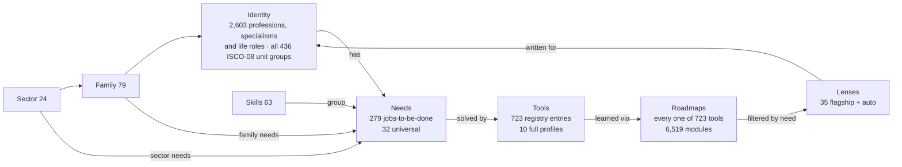

# 18 — Identity-First Discovery Specification

**Version:** 2.2 · **Date:** 21 October 2026 · **Status:** Owner direction approved (D-046 to D-052; V2.2 additions D-055 to D-059). This is the governing document for anything about professions, needs, lenses and roadmaps. Where it conflicts with 01–17, this document wins (see 00, C-18 onwards).

> **Product idea in one line.** Anyone, from a radiologist or a wells engineer to a pastor, an okada rider, a QA tester or a grandmother, answers *"Who are you?"* and immediately sees the digital tools, skills and step-by-step learning paths that matter **for their work and life**. Each tool page then shows everyone else who uses it, and how.

## 1. Why identity first
People don't arrive asking for "a pivot table". They arrive as *a nurse who needs to run an audit* or *a farmer who wants to know if the poultry batch made money*. Identity is the most human, least intimidating entry point:
- **Relevance from the first second.** The page speaks their language ("For Radiographers").
- **Clarity across domains.** Canva's page shows that real-estate agents, pastors, nurses, farmers and athletes all use it, each in a different way. That opens people's eyes.
- **Not generic.** The *same tool* gets a *different roadmap* depending on the work. Excel for financial modelling ≠ Excel for engineering calculations ≠ Excel for farm records.
- **Advisers, not just users.** After a few visits people can confidently say "as a teacher, here's how you should use Canva", so families and friends learn through them.

## 2. The model: five linked layers

| Layer | What it is | Where the data lives | Count (V2.2) |
|---|---|---|---|
| **Sector** | Human-friendly area of work or life (Health & Medicine, Energy, Faith & Community, Life roles…) | `spec-assets/taxonomy/identities/sectors.json` | 24 |
| **Family** | Group of related identities, with an ISCO-08 sub-major crosswalk | `…/families.json` | 94 |
| **Identity** | A profession, specialism (child of a profession) or life role, with aliases for search | `…/identities.json` | 2,603 (2,239 professions, 326 specialisms, 38 life roles), 4,047 searchable names; full list in `08_Starter_Catalogue/occupations/` |
| **Need** | A job-to-be-done with technology ("Build financial models", "Run worship slides and media") linked to tools | `spec-assets/taxonomy/needs.json` | 279 (32 universal) |
| **Tool registry** | Lightweight entry for every tool a need mentions: name, publisher, official link, category | `08_Starter_Catalogue/registry/tools-registry.json` | 723 |
| **Tool profile** | Full, source-backed record (pricing, platforms, limits) per V2 | `08_Starter_Catalogue/records/tools/` | 10 |
| **Roadmap** | Course outline for a tool (or a group of equivalent tools) in Beginner / Intermediate / Expert buckets | `08_Starter_Catalogue/records/roadmaps/` | 667 roadmaps covering **723/723 tools** (31 handwritten for 87 tools + 636 archetype+signature), 6,519 modules |
| **Lens** | A roadmap seen through one need, written for the professions that have it | `08_Starter_Catalogue/records/lenses/` + `generated/lens-index.json` | 35 flagship; 1,032 renderable combinations (952 with tailored modules) |
| **Skill** (V2.2) | Something people want to get good at ("Video creation and editing"), grouping needs; the second entry point (§18) | `spec-assets/taxonomy/skills.json` | 63 in 9 groups; every need belongs to ≥ 1 skill |

Editors maintain the human-readable sources in `spec-assets/taxonomy/source/` (identities, ISCO map, needs, registry, skills, archetypes, signatures, roadmaps, lenses). Every JSON file is regenerated from them with `spec-assets/generators/rebuild_all.sh` (deterministic), and `validate_identity_layer.py` must pass. Day-to-day operation is in **20 (Admin manual)**.

## 3. Identity taxonomy rules
- **Coverage goal and standard (V2.2, D-055).** Every legal occupation and everyday life role a visitor might name. Completeness is measured against the international standard, **ISCO-08 (ILO): all 436 unit groups have at least one identity** (validator-enforced), and each identity lists its `isco08_units`. On top of the standard sit the everyday and regional names people actually type (okada rider, ajo collector, talking drummer, wells engineer). V2.2 ships **2,603 identities**. Next: ESCO occupation titles as extra aliases, sector by sector (D-049).
- **Kinds:**
  - `profession`;
  - `specialism`, whose `parent` is a profession (Radiologist → Medical Doctor);
  - `life_role` (Student, Parent, Retiree, Newcomer to a Country, Person with a Disability…).
- **Aliases** are mandatory wherever people use other words, including regional ones: GP, physio, wells engineer, okada rider, keke rider, ajo collector, OAP (on-air personality), JAMB candidate.
- **ISCO-08 crosswalk.** Every non-life-role family carries an ISCO-08 **sub-major** group code (2-digit; 43 groups, `isco08-submajor.json`), and every profession carries one or more **unit-group** codes (4-digit; 436 groups, `isco08-unit-groups.json`). Codes and titles come from the ISCO-08-based CITP code list (CCSS Luxembourg) with national-only codes removed. The 4-digit mapping is AI-drafted and is part of expert validation.
- **No gatekeeping.** Identities are lenses, never permissions. Choosing "Nurse" never hides anything.
- **Sensitive identities** (Person with a Disability, Newcomer to a Country) exist to surface helpful tools. The site never stores who chose them (§10).
- **Governance.** Product owner approves additions. Retire with `retired: true` + `replaced_by` (same rules as 03 §3.1).

## 4. Needs
- A need is phrased as an action in plain language: "Check drugs, doses and interactions".
- Each need has:
  - a task family (from V2's 12);
  - a one-line description;
  - 1–12 tools in **fit order** (best general fit first; this is editorial, not a ranking of quality).
- **Universal needs** (32) apply to everyone: translation, writing clearly, AI assistants used safely, email and calendar, video calls, documents, spreadsheets, presentations, cloud files, online safety, learning online, PDFs, scanning, e-signatures, forms, job search, CV, social presence, short video, photo editing, maps, online payments, language learning and more.
- **Resolution.** For an identity, the resolved needs are three ordered groups:
  1. **Core to your work** = identity's own needs + parent's needs + family needs (de-duplicated, in that order).
  2. **Shared across {Sector}** = sector needs not already in core.
  3. **Everyone benefits** = universal needs not already listed.

  Example: Drilling Engineer → core: geomechanics, project scheduling, cost estimation (own) + well planning, drilling reporting, well performance, reservoir modelling (family) → shared across Energy: quality & HSE, regulatory reporting, production surveillance, engineering data analysis → everyone: translation, AI assistants…

## 5. Tool registry vs tool profiles
- **Registry entries** give breadth: name, publisher, official link (`url_status: to_confirm` until the link checker passes) and category. **They make no pricing, platform or feature claims**: `pricing_model` is always `unknown`, displayed as "Check the official site for pricing".
- **Full profiles** (V2 tool schema) give depth: verified pricing, platforms, limitations and sources. A registry entry becomes `profiled` when its full record is published (validator enforces the pairing).
- Registry-only tools appear in need cards and "who uses" lists with a "Profile coming soon" note. Their roadmap and lenses still work if a roadmap exists.

## 6. Roadmaps (course outlines)
- **Coverage standard (V2.2, D-056):** every registry tool has a roadmap. The validator fails the build below **90%** (currently 100%). Roadmaps come in tiers (20 §5.4):
  - **handwritten** (31 roadmaps for 87 tools);
  - **archetype + signature** (636 tools): one of 49 tool-type templates (CAD/BIM, payments, EHR, DAW…) plus that tool's own core and advanced skills, in its own vocabulary (Revit → Dynamo, worksharing; TradingView → Pine Script);
  - **expert-validated** (any tier, post-MVP).

  Every generated roadmap has 10 modules:
  - Beginner: Get started, plus 2 archetype modules;
  - Intermediate: 2 archetype modules, plus **Signature skills in {tool}**;
  - Expert: **Advanced {tool}**, an archetype module, Integrate, and Lead & teach others.

  Generated roadmaps are labelled "Course outline (standard)" on screen, and handwritten ones "Course outline (in depth)".
- A roadmap belongs to one tool **or a group of equivalent tools**. For example, "Spreadsheets" applies to Excel, Google Sheets and LibreOffice Calc; "AI assistants" applies to Claude, ChatGPT, Gemini and Copilot.
- **Three buckets:** Beginner (can use it), Intermediate (productive at work), Expert (can build, automate and teach others).
- **Each module has:**
  - title;
  - an outcome ("You can …");
  - topics;
  - a practice task;
  - need tags;
  - an estimated hours value labelled as an estimate.
- **No video-platform links** (D-043). Modules describe *what to learn and practise*. Learning resources link to official documentation and text resources; learners can search for videos themselves.
- **Progress tracking** is R2 (needs accounts). In R1, each module has an in-page "I can do this" checkbox stored only in the browser (`localStorage`, with try/catch), with a note: "Saved on this device only."

## 7. Lenses: the anti-generic engine
A lens answers: **"How does someone doing *this work* use *this tool*, and what should they learn first?"**

**Composition algorithm** (deterministic; reference implementation in `generated/lens-index.json` and the build script):
1. **Priority modules** (flagship lens only): in the order written by the editor.
2. **Need-tagged modules:** every roadmap module whose `need_tags` include the lens's need, in roadmap order.
3. Steps 1 and 2 are the **"Core for you"** path. All other modules are shown collapsed as **"Also useful"**, grouped by level.
4. **Extra modules** (flagship only): profession-specific modules inserted at the top of their level and marked "Specific to {need}". These are what make lenses non-generic: for example, "Survey calculations (minimum curvature)" in *Excel for drilling and well engineers*, or "Run charts" in *Excel for clinical audit*.
5. **Flagship lenses add:**
   - why it matters;
   - what is different from generic use;
   - a starter project;
   - pitfalls;
   - tools that pair well.
6. **Auto lenses** (no flagship) show the need description, the composed path and the identity's other needs that use the same tool. If no module is tagged with the need, show the full roadmap with the note "This roadmap isn't yet tailored for {need}. Here's the full outline."

**Example of the difference** (from the shipped data):

| | Excel for financial modelling | Excel for engineering calculations | Excel for farm records |
|---|---|---|---|
| Written for | Financial analysts, FP&A, investment bankers, founders… | Civil, structural, mechanical, chemical engineers… | Crop, poultry, fish farmers, cooperatives… |
| First modules | Formulas → model design → logic & lookups → what-if | Formulas → logic → what-if → model design | Basics → tables → formulas → logic |
| Specific modules | Keyboard-first working · Three-statement model · Timing flags · Valuation (XNPV/XIRR, DCF) · Scenarios & model review | Units & engineering notation · Checkable calc sheets with clause references · Interpolating code tables · Iteration (Colebrook) · Verification & QA | Phone-friendly record sheets · Gross margin per hectare/bird/pond |
| Starter project | Three-statement model + DCF with 3 scenarios | Checked retaining-wall or pipe-sizing calc workbook | One full season's records ending with break-even price |

**Choosing the lens for an identity** (route `/for/{identity}/{tool}`):
1. Walk the identity's resolved needs in order (core → sector → universal).
2. Pick the first need whose tools include the tool and that has a flagship lens. If none, pick the first need that has any lens.
3. Show that lens with an identity-specific intro ("How Drilling Engineers use Excel"), plus "Other ways {identity}s use {tool}": the other matching needs as tabs.

## 8. Screens and routes (adds to 03 §1 and 04)
| ID | Route | Purpose |
|---|---|---|
| S01 (revised) | `/` | Question-led home: "Who are you?" then "What would you like to do?" (§9) |
| S27 | `/for/{identity}` | Your digital toolkit: needs grouped as core, sector and universal; tools and lenses per need; specialisms; related identities; "Helping a {identity}?" share card |
| S28 | `/for/{identity}/{tool}` | How {identity}s use {tool}: the chosen lens plus other matching needs |
| S29 | `/tools/{tool}/for/{need}` | The canonical lens page (shareable; identity-neutral) |
| S30 | `/tools/{tool}/roadmap` | Full course outline in three buckets, with a lens switcher ("See this for: [your profession ▾]") |
| S31 | `/needs/{need}` | One job-to-be-done: tools in fit order, identities that have it, lenses |
| S32 | `/sectors/{sector}` | Families and identities in a sector, plus the sector's shared needs |
| S33 | `/who-are-you` | Full A–Z and by-sector browser of every identity (no-JS fallback for the picker) |
| S09 (revised) | `/tools/{tool}` | Adds **Who uses {tool}** (identities grouped by sector, top 8 per sector + "See all"), **Surprising uses** (the 3 sectors furthest from the tool's home category), **Skill roadmap** summary, and a **lens switcher** |
| S07 (replaced) | `/for/{audience}` | The V2 audience pages become identity pages. V2 audience slugs (student, professional…) map to identities or life roles via redirects |

**Registry-only tool pages:** `/tools/{tool}` exists for every registry tool. It shows name, publisher, official link, "Who uses it", any roadmap and lenses, and the note "We haven't profiled this tool's pricing and platforms yet". These pages are `noindex` until profiled **unless** a roadmap exists (14 §1 rule update).

## 9. The question-led home page (S01 revised)
**Above the fold, in this order:**
1. H1: "Make technology your advantage." (D-002, unchanged)
2. Supporting line: "Tell us who you are. We'll show you the tools, skills and next steps that matter for your work and life."
3. **Step 1: "Who are you?"**
   - **Identity picker:** a combobox with type-ahead over 4,047 names, plus a second suggestion group, **Skills** (§18), when the text matches a skill better than a person ("video editing"). Placeholder: "e.g. nurse, civil engineer, pastor, student, farmer".
   - Pick **up to 3** identities. Each choice becomes a removable chip (people are often more than one thing: "Nurse" + "Content creator").
   - Example chips (tap to add): I'm a student · I run a small business · Nurse · Civil engineer · Pastor · Content creator · Farmer · Software developer.
   - A link "Browse everyone →" goes to S33.
   - A toggle "I'm helping someone else" switches the copy to "Who are you helping?" (§11).
4. **Step 2: "What would you like to do?"** This appears after an identity is chosen and is also usable on its own.
   - **Need chips:** the top 6 core needs of the chosen identity (combined across up to 3 identities, interleaved), plus 2 universal needs. Selecting one goes to the lens or need page.
   - A free-text search box ("Or describe what you want to do…") that uses the normal search.
   - Primary button: "Show my toolkit" → S27 (or, for 2–3 identities, `/for/{a}+{b}` combined toolkit, max 3).
5. **If no identity is chosen,** the V2 example queries remain as "Or jump straight to a goal": Edit videos for free · Research a topic · Automate repetitive work · Build a website · Learn a digital skill.

**Below the fold:**
- "Everyone gets a digital upgrade": a rotating, static grid of 12 diverse identities (radiographer, wells engineer, okada rider, imam, QA tester, farmer, retiree…). Each card shows two of that identity's tools.
- How it works (Who are you → What you need → Tools → Your roadmap).
- Trust strip.
- Footer.

**Remembering identity:** the chosen identities are stored **only in the browser** (`localStorage['da-identities']`, try/catch) so the home page says "Welcome back — continue as a Nurse?" with a "Not me" link. Nothing is sent to the server, and analytics never record the chosen identity (§10).

## 10. Privacy of identity
- Identity choices are never sent to analytics with any identifier.
- The `identity_selected` event records only the identity's **sector**, aggregated per day, and **never** for sensitive life roles (`person-with-a-disability`, `newcomer-to-a-country`, `family-carer`, `parent-of-a-disabled-child`), which are counted only as `life_role`.
- Identity routes are ordinary public pages, so visiting `/for/radiologist` reveals nothing beyond a normal page view.

## 11. "Helping someone else" (advise family and friends)
- **Toggle on home:** "I'm helping someone else", for example "My mum is a nurse" or "My friend is a farmer".
- **Identity pages get a "Share this toolkit" card:**
  - a printable one-page **Toolkit card** listing the identity's top 6 needs, the best starter tool for each, and the first module of each roadmap;
  - a share link;
  - a plain-text version for WhatsApp, under 1,000 characters.
- **Lens pages get "Explain this to someone":**
  - a short plain-language summary (why, first 3 modules, starter project);
  - a share or print option.
- **Goal:** the person who used the site becomes the expert in their circle. Copy is written so it can be read aloud.

## 12. Indexing and quality rules for thousands of pages
| Page type | Indexable when | Otherwise |
|---|---|---|
| Identity `/for/{identity}` | ≥ 3 core needs **or** the identity has its own needs or a flagship lens | `noindex`; canonical points to the parent identity or the family's lead identity |
| Identity × tool `/for/{i}/{t}` | A flagship lens exists for the chosen need **and** the identity is in its `for_identities` | `noindex`; canonical to `/tools/{t}/for/{need}` |
| Lens `/tools/{t}/for/{need}` | Flagship, or auto with ≥ 2 core modules | `noindex` |
| Roadmap | Always | — |
| Need | Always | — |
| Registry-only tool | Has a roadmap | `noindex` |

This keeps thin, near-duplicate pages out of search engines while every page remains useful to visitors (Gap Analysis §25, V1 02 §10).

## 13. Content status and expert validation
- **Owner direction (D-044):** "Assume it's all perfect for now. Domain experts will validate later." All taxonomy, needs, roadmaps and lenses are therefore **published for MVP** under the owner's blanket approval.
- Every identity, need, roadmap and lens carries `expert_validation.status` (`pending` → `in_review` → `validated`).
- Public pages show a small, non-alarming line in the trust footer: "Guidance reviewed by: the Digital Advantage team · Expert review: pending". When validated it reads "Expert-reviewed by {name, role} on {date}" (with consent).
- **Factual claims about tools** (pricing, platforms, licences) still follow V2's evidence policy. Registry entries make none, and full profiles require sources. Editorial guidance (needs, roadmaps, lenses) may be AI-drafted and is labelled as guidance, not fact.
- **Expert programme (post-MVP):**
  - recruit 1–2 practitioners per sector;
  - each validates their sector's identities, needs and lenses through a review form;
  - credit them on the page (with consent).

## 14. Search integration
Configuration lives in `spec-assets/search/search-config.json` → `identity_search`.
- A separate lightweight index, `/api/v1/identities-index.json`, powers the picker and the identity group in every search box. At 2,603 identities it is about 49 KB gzipped with family labels inlined (about 41 KB if families and sectors are sent as numeric references to a small lookup table, **recommended** to keep headroom). Either way it is within the 60 KB budget. A tiny skills index (`/api/v1/skills-index.json`, about 21 KB raw and 6 KB gzipped) powers the Skills group.
- **Type-ahead behaviour:**
  - prefix matching;
  - fuzzy matching on terms of 5 or more characters;
  - plural stemming;
  - phrase cleanup ("I'm a pastor");
  - aliases ("okada", "wells engineer", "physio").
- **Combined queries:** "excel for civil engineers" goes straight to `/for/civil-engineer/microsoft-excel`.
- **Tests** (all passing on 21 Oct 2026, via `identity-harness.mjs`): 32 identity queries (including 12 music identities), 4 route queries and 12 skill queries in `search-test-set.json`: 48/48.

## 15. Analytics additions (aggregate only; see 14 §2)
| Event | Props | Notes |
|---|---|---|
| `identity_selected` | `sector` (or `life_role` for sensitive roles), `source` (home_picker, example_chip, browse) | Never the identity slug |
| `need_chip_selected` | `task_family` | |
| `lens_viewed` | `kind` (flagship/auto), `roadmap` | |
| `module_marked_done` | `level` | Local checkbox; no identity |
| `toolkit_shared` | `method` (native, copy, print, whatsapp_text) | |
| `helping_mode_toggled` | — | |

## 16. Acceptance criteria (new tests TC-071 to TC-090, in 15 and the CSV)
Headline criteria:
- Typing "rad" shows Radiologist and Radiographer within 150 ms of the index loading.
- "okada" finds Motorcycle Taxi Rider.
- "excel for civil engineers" routes to the right lens.
- A visitor who picks Nurse + Content creator sees needs from both identities interleaved, and nothing is hidden from search.
- Canva's tool page lists identities from at least 10 sectors under "Who uses Canva" (the data gives 19).
- *Excel for financial modelling* and *Excel for engineering calculations* show different first five modules and different specific modules.
- No video-platform links anywhere in content records (the validator enforces this).
- The identity is stored on the device only; no request body ever contains an identity slug.

## 17. Scale-out plan
| Step | What | Who |
|---|---|---|
| 1 | Publish V2.2 data (2,603 identities, 279 needs, 63 skills, 723 tools, roadmaps for all 723, 35 flagship lenses) | Build team |
| 2 | Weekly link check on all 723 registry URLs; every registry entry now has an official link (V2.2), so any blank link is a new entry to confirm | Automated + editor |
| 3 | Profile the 50 most-referenced registry tools (Excel, Canva, Google Docs, WhatsApp, Zoom, Power BI, Python…) to full V2 records | Editors |
| 4 | Upgrade 20 roadmaps per quarter from archetype+signature to handwritten, prioritised by `who-uses-each-tool.json` identity counts (20 §5.4) | Admin + educators |
| 5 | ISCO-08 unit groups done (V2.2). Next: ESCO titles as aliases, sector by sector | Admin + sector experts |
| 6 | Expert validation programme (§13) | Product owner |
| 7 | Localisation of identities and needs (Yoruba, Hausa, Igbo, French, Arabic, Swahili, Portuguese…) once English is stable | Post-MVP |

## 18. More than one way in: "Explore by" (V2.2, D-058)
Identity stays the **front door**: the landing question is still "Who are you?". But some people think in skills ("I want to get good at video editing"), tools ("What can Excel do for me?") or sectors. Every entry point leads into the same graph, so nobody hits a dead end.

**The switcher.** Directly under the H1 on S01, a compact segmented control (on mobile, horizontally scrollable chips):

| Tab | Question shown | Input | Leads to |
|---|---|---|---|
| **Who are you?** (default, selected) | "Who are you?" | Identity picker (§9) | `/for/{identity}` |
| **What do you want to do?** | "What would you like to do?" | Need chips + free-text search | `/needs/{need}` or search |
| **Skills** | "What do you want to get good at?" | Skill picker + 9 skill-group chips | `/skills/{skill}` |
| **Tools** | "Which tool do you want to master?" | Tool search (registry) | `/tools/{tool}` → roadmap |
| **Sectors** | "Which area do you work in?" | 24 sector cards | `/sectors/{sector}` |

**Rules:**
- The selected tab is remembered on the device (`localStorage['da-explore-mode']`, try/catch). The default is always "Who are you?" for first-time visitors.
- Each tab is an ordinary link with a real URL (`/?explore=skills`), so it works without JavaScript and can be shared. Use `role="tablist"` and arrow-key navigation (13).
- **Cross-suggestions in every box:** typing a skill in the identity picker shows a "Skills" group; typing a tool shows a "Tools" group; typing a profession in the skills box shows "People" first. Nobody needs to know which tab they're on.
- **Identity is always one tap away:** skill, tool and need pages show a slim bar: "See this for your work: [Who are you? ▾]". Choosing an identity there re-orders modules with the right lens.

**New screens and routes:**

| ID | Route | Purpose |
|---|---|---|
| S34 | `/skills` | All 63 skills in 9 groups (Digital foundations, Communication and writing, Design and media, Data and analysis, Research and verification, Business and marketing, Work and career, Technology and engineering, Sector practice systems). Each card: label, one line, "{n} tools · used in {m} professions". |
| S35 | `/skills/{skill}` | One skill. Beginner, Intermediate and Expert descriptors; the needs it covers (cards); its tools ranked (top 8, then "See all"); their roadmaps; "Professions that rely on this" (top identities by sector); and "Pick your profession to tailor this". |

**Data:** `spec-assets/taxonomy/skills.json` (schema `skill.schema.json`), generated from `skills.txt` and `skill_keywords.txt`. Tools, roadmaps and identity counts are derived, never hand-maintained.

**Indexing:** `/skills` and `/skills/{skill}` are always indexable (they're substantial and unique). **Analytics:** `explore_mode_changed` (mode) and `skill_selected` (group, source), aggregate only.

## 19. Occupations directory (V2.2)
`08_Starter_Catalogue/occupations/occupations-directory.csv` and `.md` list every identity with:
- kind;
- parent;
- sector;
- family;
- ISCO-08 sub-major and unit-group codes;
- aliases.

The S33 "Browse everyone" page renders from the same data. These files are generated (`export_occupations.py`), so experts can review in a spreadsheet and send changes back through the admin (20).

## 20. V2.3 notes
- **Music release layer:** two needs, *Release your music on streaming platforms* and *Grow your audience on streaming platforms*, plus BandLab, DistroKid, TuneCore, Spotify for Artists and Audiomack, and a "music-release" roadmap archetype. They are attached to the Music family, with links verified on 21 Oct 2026.
- **Data roles corrected:** data pipelines are now a Data Engineer need, not a family-wide one. Data Analysts (and BI Analysts) now have SQL, dashboards, spreadsheets, data cleaning, charts, KPIs and statistics as their core needs.
- **Auto-lens titles** read "Using {Tool} to {need}" (04 S29).
- **Starter journeys and contribution:** see doc 22.
